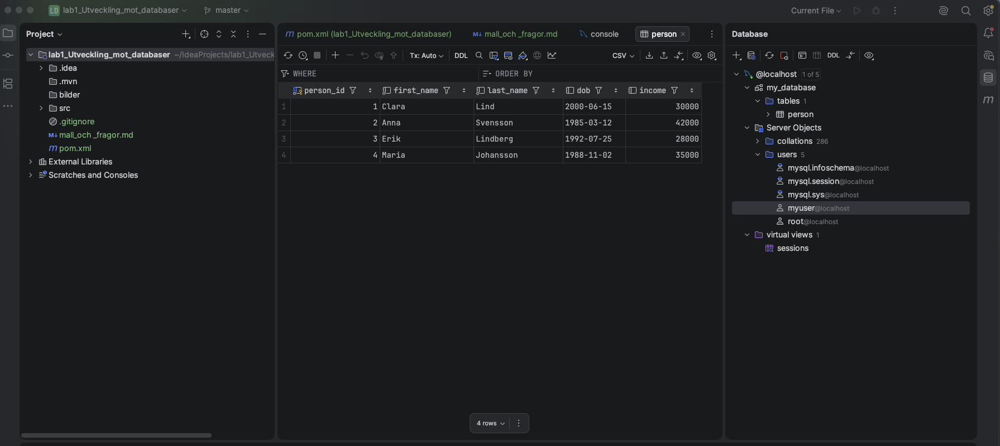
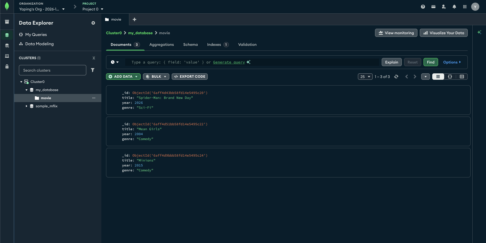
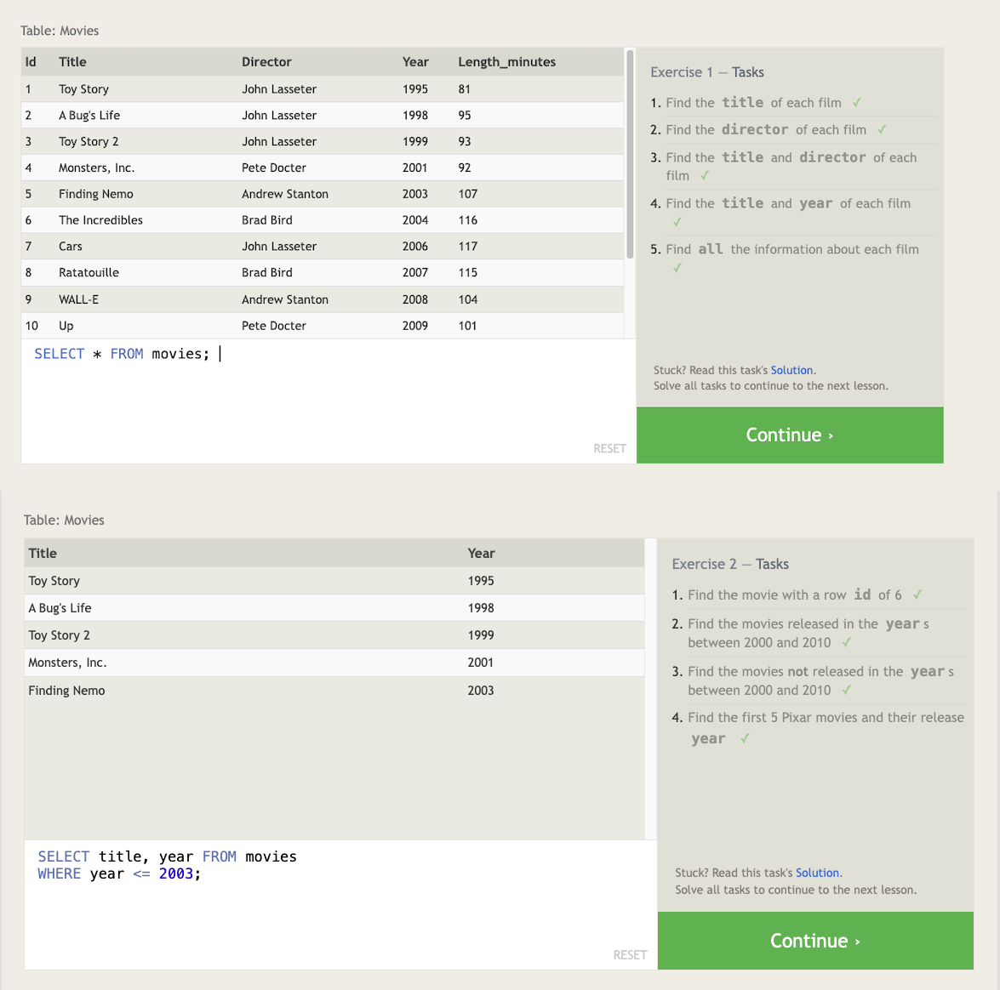

# Labb 1

# MySQL

Skärmdump som visar database explorer i IntelliJ med skapad person-tabell med data:

NOT: Ni ska även ha skapat en user som bara har access till databasen my_database, ingen bild krävs

# MongoDB

Skärmdump av databas på MongoDB Atlas med skapad movie-collection med data:

# SQL

Skärmdump som visar att ni klarat av första två sidorna på sqlbolt.com:s interaktiva tutorial

# Frågor som ni ska svara på (G-nivå)

Besvara frågorna med egna ord. Ge gärna exempel.

## Databaser och verktyg

1. Vad är en databas, och vad kan den användas till?
   
   A database is an organized collection of data stored in such a way that information can be quickly found, modified, 
   and added.

2. Vad används språket SQL till?

   SQL is used to create tables and to retrieve or modify data in a relational database.

## Tabeller och relationer

3. Vad är en tabell, en rad och en kolumn?
   
   A table stores data about one kind of thing, for example person. A column is one property of that thing, such as 
   first_name or income, and every row has a value for it. A row is one record in the table

4. Vad är en primärnyckel, och varför behövs den?
   
   Primary Key is a unique identifier for each row in a table.It is needed so that each row can be identified exactly,
   even if two people have the same name

5. Vad är en främmande nyckel?
   
   Foreign Key: A reference to a primary key in another table, used to create relations between tables.

6. Varför är det bra att lagra kunduppgifter och köp i olika tabeller?

   Because customer details can only be stored once, in a `customer` table. Each purchase then just refers to the customer 
   with a foreign key. This avoids repeating the same name and address in every purchase row, and if a customer moves, 
   I only have to update one row.
   

## NoSQL

7. Vad menas med NoSQL, och hur kan information organiseras i en sådan databas? 

   NoSQL means databases that do not use the traditional table-and-SQL model. They are often more flexible about 
   structure and are built to scale easily. Data can be organized in different ways: as documents (JSON-like, 
   e.g. MongoDB), as key-value pairs (e.g. Redis), in column families (e.g. Cassandra), or as graphs with nodes and 
   relationships (e.g. Neo4j).

8. Ge ett exempel på när en NoSQL-databas kan vara lämplig och förklara varför.

   A NoSQL database is suitable for a shopping cart in a web shop. A key-value database such as Redis can store one 
   entry per user, where the key is the user id and the value is the cart content. The cart is read and changed very 
   often and must be fast, but it does not need relationships to other tables or complex queries, so a simple key-value 
   store is a better fit than a relational database.

## SQL – hämta data från tabellen person

Skriv en SQL-fråga som svar på varje uppgift.

9. Hämta alla kolumner för alla personer i tabellen.

         SELECT * FROM person;
   

10. Hämta endast förnamn och efternamn för alla personer. 

         SELECT first_name, last_name FROM person;

11. Hämta förnamn, efternamn och inkomst för personer med en inkomst över 30 000.
   
         SELECT first_name, last_name, income FROM person WHERE income > 30000;

12. Hämta alla personer födda före den 1 januari 1990.

         SELECT * FROM person WHERE dob < '1990-01-01';

13. Hämta förnamn, efternamn och inkomst, sorterat efter inkomst från högst till lägst.

         SELECT first_name, last_name, income FROM person ORDER BY income DESC;

14. Räkna hur många personer som finns i tabellen.

         SELECT COUNT(*) FROM person;

# VG-nivå

Dessa frågor ska besvaras med ett längre svar, minst en halv A4-sida:

1. En banköverföring avbryts efter att pengarna dragits från det första kontot.
   Vad kan konsekvensen bli, och hur kan en transaktion hjälpa?

   A bank transfer has two steps. First the money is taken from account A, and then it is added to account B. If the 
   transfer stops after the first step, for example because the server crashes or the network goes down, the money has 
   left account A but never arrives at account B. So the money basically disappears. The customer loses money, the total
   amount in the bank is wrong, and someone has to find the problem and fix it by hand.

   A transaction helps with this because it groups several operations into one unit, so they either all happen or none 
   of them happen.

   
   

2. Välj ett enkelt system, antingen en webbutik eller en chatt.
   Resonera om när en relationsdatabas respektive en NoSQL-databas
   kan vara lämplig. Motivera med hur informationen ska lagras och användas.

   I chose a web shop. It has customers, products, orders and payments, and they are connected: a customer can make many 
   orders, and an order can contain many products.
   
   A relational database like MySQL is good for customers, orders and 
   payments. I would make tables like customer, product, orders and order_line, and use a foreign key customer_id in 
   orders to connect each order to a customer. That way each customer is saved only once. Transactions are also 
   important: when someone buys something, the stock must go down, the order must be created and the payment must be 
   saved. Either everything works or nothing happens, otherwise a customer could pay without getting an order. SQL also 
   makes it easy to combine data, for example with JOIN and GROUP BY to see how much each customer has bought. 
   
   A NoSQL database like MongoDB is good when the data looks different or there is a lot of it. A laptop has processor 
   and memory, a shirt has size and colour, and a book has author and pages. In a document database each product can be 
   one document with exactly the fields it needs, so new product types are easy to add. Reviews and shopping carts (for 
   example in Redis) are other good examples. In a real shop I think both are often used: relational for orders, 
   customers and payments where correct data is important, and NoSQL for products, reviews and carts where flexibility 
   and speed matter more.
